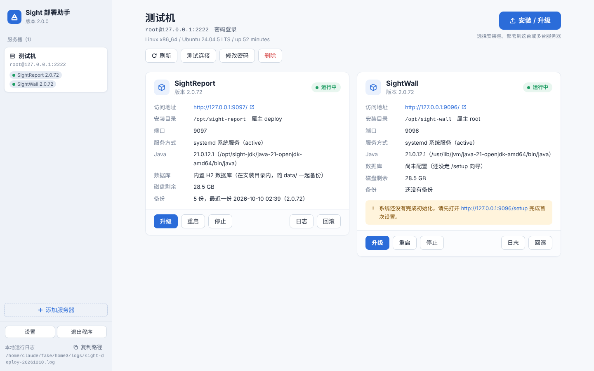
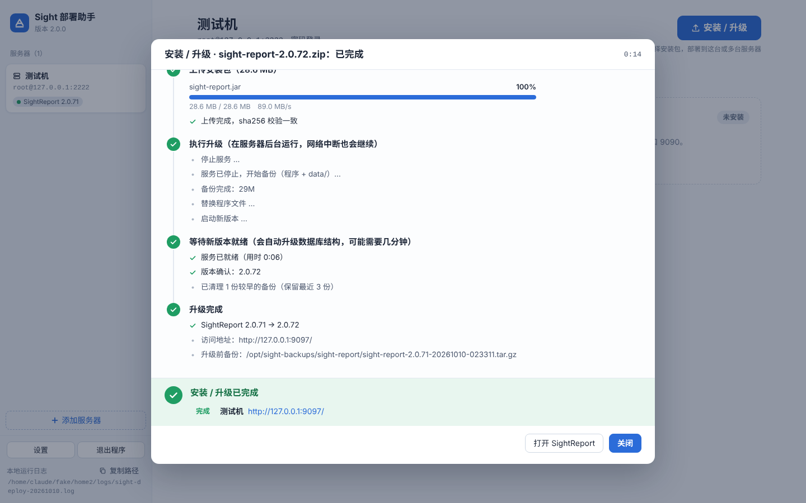

# Sight 部署助手

[](https://github.com/Sight-Data/sight_deploy/actions/workflows/build.yml)
[](https://github.com/Sight-Data/sight_deploy/releases)
[](LICENSE)
[](https://www.sightdata.top)

[**Sight Data**](https://www.sightdata.top) 旗下 **SightReport（报表）/ SightWall（数据大屏）/ Sight DataLink（数据集成）/ Sight 移动网关** 的远程安装与升级工具。

双击打开，界面在一个独立窗口里（像桌面客户端，没有地址栏和标签页）。通过 SSH 连到 Linux 服务器，三步完成部署：添加服务器 → 选择安装包 → 一键安装 / 升级。
不用敲命令，客户电脑上也不用装 Python。

<table>
<tr><td width="50%">

**服务器状态一目了然**



</td><td width="50%">

**升级过程全程可见，失败可一键回滚**



</td></tr>
</table>

> 截图中的地址、目录均为测试环境数据。

## 下载

| 系统 | 文件 | 说明 |
|---|---|---|
| Windows 10 / 11 | `sight-deploy-<版本>-windows-x64.exe` | 单文件，双击运行 |
| Windows 7 / 8 | `sight-deploy-<版本>-windows7-x64.exe` | Win7 兼容版（Python 3.8 构建）。系统自带的 IE 打不开操作界面，需要装 Chrome 109 或 Firefox ESR 115；程序会优先用它们打开（Chrome 为应用窗口，Firefox 为普通浏览器标签页） |
| macOS（Apple 芯片） | `sight-deploy-<版本>-mac-arm64.zip` | 解压后打开「Sight部署助手.app」 |
| macOS（Intel） | `sight-deploy-<版本>-mac-x86_64.zip` | 同上 |

- **GitHub**：[Releases](https://github.com/Sight-Data/sight_deploy/releases)
- **国内下载**：[Sight Data 官网下载中心](https://www.sightdata.top/downloads)

操作界面用电脑上的 **Edge / Chrome 的「应用窗口」** 打开：独立窗口、没有地址栏，不用额外安装任何东西（Windows 10/11 自带 Edge）。没有这两个浏览器（如只装了 Safari / Firefox）时，退回用默认浏览器打开。想一直用普通浏览器，启动时加 `--browser`，或设环境变量 `SIGHT_DEPLOY_BROWSER=1`。
应用窗口用独立的浏览器配置（保存在 `~/.sight-deploy/app-window/`），不受平时浏览器的设置、登录状态影响。程序本身常驻在后台：
- **Windows**：运行后任务栏右下角通知区会出现它的图标（可能收在「^」里）。双击图标重新打开界面，右键「退出」关闭程序。
- **macOS**：菜单栏右上角有图标，菜单里可以重新打开界面或退出。
- 界面左下角也有「退出程序」按钮；关掉窗口 10 分钟后，程序在没有任务进行时会自动退出。

程序没有做代码签名：
- **Mac**：第一次打开会提示「无法验证开发者」，右键 →「打开」即可。macOS 15 起要到「系统设置 › 隐私与安全性」点「仍要打开」。
- **Windows**：个别杀毒软件可能误报，加入信任即可。

SightReport / SightWall / Sight DataLink / Sight 移动网关的产品安装包同样在[官网下载中心](https://www.sightdata.top/downloads)下载（Sight DataLink 的包名为 `sight-datalink-<版本>.zip`；Sight 移动网关按服务器 CPU 分包，包名为 `sight-mobile-gateway-<版本>-linux-<amd64|arm64|loong64>.zip`，不要改名）。

> Sight DataLink 按它自己的 Sustainable Use License 分发，见 [LICENSING.md](https://github.com/qianxl2011/DataLink/blob/main/LICENSING.md)；本工具（Apache-2.0）只负责安装与升级。

## 能做什么

- **服务器管理**：支持 root 账号，或可以 sudo 的普通账号；支持密码或密钥登录。
  - 密码加密保存在本机，密钥与本机绑定。
  - 首次连接记录服务器指纹，下次指纹变了会提醒。
- **首次安装**：先检查环境，包括系统与 CPU 架构、systemd、Java 21、字体库、内存、磁盘、端口、防火墙。
  - 缺 Java 时可以上传本机的 JDK 包，自动核对版本和架构。服务器能联网的话，也可以用 yum/apt 在线安装。
  - 调用产品包里的 `install.sh` 注册成 systemd 服务，开机自启、崩溃自动拉起。
  - 健康检查通过后给出 `/setup` 初始化地址，需要的话顺手放行防火墙端口。
  - Sight DataLink：首次启动进入安装向导（根路径 `/`），从服务日志里取出「初始化令牌」显示在完成页上（可一键复制，安装向导和之后的「初始化管理员」都要用它；令牌不写进本地日志）。元数据库连不上时说明服务在等待并自动重试。
- **升级**：
  - 服务还在运行时先上传安装包，支持断点续传和 sha256 校验，尽量缩短停机时间。
  - 「停服 → 备份程序和 `data/` → 替换程序 → 启动」这一段在服务器后台执行，网络断了也会执行完。
  - 启动后检查健康状态并核对版本号，失败时一键回滚，程序和数据一起恢复。
  - 用外部数据库时会提醒先备份数据库。
  - Sight DataLink 用外部元数据库时，升级前必须勾选确认已备份；PostgreSQL 且服务器上有 `pg_dump` 时可勾选让本工具先备份到 `sight-backups/`（`sight-datalink-db-<版本>-<时间>.dump`；密码经 `PGPASSWORD` 传入，不出现在命令行和日志里；与程序备份一样按「保留份数」清理较早的，只清理本工具按这个命名生成的文件）。升级前记录数据库结构版本（`schemaVersion`），回滚时外部库结构版本变了就拒绝只回滚程序，提示先用数据库备份恢复；内置 H2 在 `data/` 里，随备份一起恢复。
  - Sight DataLink 升级后新版本持续 60 秒处于等待模式（`mode=waiting`，连不上元数据库）时，不再等满「等待服务就绪秒数」：直接说明「服务已启动但连不上元数据库」并显示最近一次连接错误（口令打码），随后照常显示日志、询问是否回滚。首次安装时等待模式不算失败。
  - 可以多选服务器依次滚动升级，某台失败时会询问是否继续处理剩下的。Sight DataLink 不做自动滚动升级：多选时提醒集群（共用外部库）要先全部停止、先升级一台等迁移完成再升级其余，确认后才依次处理。
- **同机多实例**（只用于 SightReport 集群）：已安装的 SightReport 卡片上「再装一个实例」：同一台服务器上再装一套（单独的目录 `/opt/sight-report-<实例名>`、端口、系统服务 `sight-report-<实例名>`），需要 2.0.117 及以上的完整安装包。
- **集群**（只支持 SightReport，SightWall 只做单实例部署。几个实例连同一个外部数据库、在管理台开启集群模式，前面一个 nginx 入口）：
  - 识别：刷新状态时记下每个实例的数据库地址指纹（只存指纹，不存地址），同一个库的实例 ≥2 个时侧栏提示「归为一个集群」；也可以手工新建。
  - 入口：选一台服务器做入口，部署助手检查 nginx（≥1.18）；没有时可选从系统软件源安装，或用官网提供的**离线 nginx 包**（x86_64 / ARM64，静态编译、不依赖系统库，这台电脑下载后经 SSH 上传，装到 `/opt/sight-nginx`、系统服务 `sight-nginx`；软件源装不上时自动建议改用它；版本过低时提醒升级）。部署助手只写自己的两个文件 `/etc/nginx/conf.d/sight-<集群>.conf`、`/etc/nginx/sight/<集群>-proxy.conf`，不改主配置；写入后 `nginx -t`，通过才重载，不通过恢复上一份。上游就是集群的实例表；未就绪（503）的实例自动换一台，`/assets/` 在新旧版本间 404 也换一台，`/api/machine/` 不经入口暴露，WebSocket 日志不记查询参数（令牌）。实例可以手工「摘下 / 放回入口」。
  - 扩容：在选定的服务器上装一个新实例，数据库连接（`data/work/database.config` / `MR_DB_*`）和整组加密配置（`SIGHTDATA_*_KEY`、`SIGHTDATA_CRYPTO_AES_GCM`）从已有实例拷过去，写进新实例的 `sight.env`（600），**不走安装向导**；就绪后挂进入口，插件一并拷过去。新机器会给出机器身份（`install.sh identity`），用于重签集群授权。
  - 集群升级：新包的 `release.json` 声明了可混跑的最低版本（`rollingFrom`），且所有实例都不低于它 → 滚动升级：逐个实例「从入口摘下 → 停止（实例内完成下线）→ 备份并升级 → 等 `/api/health/ready` 且版本对上 → 放回」；否则整体停机升级（全停 → 升第一个执行数据库迁移 → 再升其余）。某个实例失败就停在那里、不放回入口，已升级的不自动回滚。
  - 集群页：每个实例的版本、就绪状态、leader、加密配置是否一致（只在本机比较散列），入口 nginx 的状态与经入口访问是否正常。
- **Sight 移动网关**（SightReport 配套的手机访问入口，Go 单文件程序，部署在手机能访问到的前置机 / DMZ 上，**不是 SightReport 所在的那台机器**；没有 Java、没有数据库，不用联网）：
  - 首次安装：检查 CPU 架构与安装包一致（`uname -m` 的 x86_64 / aarch64 / loongarch64 对应 amd64 / arm64 / loong64）、systemd、手机侧端口（默认 8080）和隧道端口（7443）是否被占用、磁盘。界面里填「SightReport 访问网关用的域名或 IP」（可多个，会写进证书）和手机侧端口，然后上传解压 → 先在服务器上试跑 `version` → `init -hostnames …` → `install` → `start` → 用 `curl -sk https://127.0.0.1:7443/healthz` 确认返回 `{"agents":n}`。
  - 安装完成页醒目显示**网关地址、证书指纹、接入令牌**（可一键复制），并写明下一步：到 SightReport「移动 › 设置 › 网络与部署」启用移动网关，网关地址填 `wss://<主机>:7443/tunnel`。令牌是机密：只显示在界面上，不写进本地日志和历史记录；之后可在服务器详情点「查看接入信息」（执行 `show`）再看。
  - 升级：停服务 → 备份旧程序（`sight-backups/sight-mobile-gateway/*.bin`）→ 替换 → 启动 → 核对 `sight-mobile-gateway version` 等于新版本且 `/healthz` 正常；新程序会在停服务之前先在服务器上试跑一次。失败时自动放回旧程序，也可以一键回滚。**`gateway.yaml` 和 `data/` 绝不覆盖**，接入令牌和证书指纹不会变，SightReport 里不用重新填。
  - 状态页显示版本、服务状态和 SightReport 连接数（`agents`）；连接数为 0 时提示「SightReport 还没有连上来」。
  - 版本配套：网关版本必须与 SightReport 一致。升级 SightReport 后，助手里登记的移动网关版本不同，会提醒「移动网关需同步升级到 x.y.z」；网关卡片上也会提示。
  - 只支持 Linux 服务器（Windows 请用网关安装包里的说明手工部署）。
- **在线检查更新**：启动时（可在设置里关闭）联网查询官网下载中心，只读取版本信息，不上传任何数据。
  - 有新版本时点「下载新版本」，下载完成后点「立即更新并重启」：程序退出、换成新版本并自动重新打开，服务器信息保留。Windows 打包版和 Mac 的 .app 都支持。覆盖前会先校验下载的文件；每一步记在 `~/.sight-deploy/update.log`，没更新成功时看它。Mac 需要先把 .app 从「下载」拖到「应用程序」再打开（直接在「下载」里打开的无法自动替换，需手动解压替换）。
  - 部署助手有新版本时，页面顶部提示，点一下就下载到「下载」文件夹（断点续传）。
  - 服务器上的 SightReport / SightWall / Sight DataLink / Sight 移动网关低于官网最新版时，在产品卡上标出；点「升级」会预选最新版，没下载过的自动从官网下载并校验，再部署。
  - 左下角「检查更新」随时手动检查，并汇总哪些服务器可升级。连不上官网（内网）时不影响使用，仍可用本机的安装包。
- **日常运维**：启动、停止、重启；查看日志（可实时跟踪）；回滚到任意一份升级备份。回滚前会先把当前状态另存一份，回滚本身也能撤销。

## 安全

- 网页服务只监听本机 `127.0.0.1`，每次启动生成一个随机令牌。接口只认请求头里的令牌，并拒绝跨站请求：浏览器里的其他网页用不了它。
- 本机保存的数据都在 `~/.sight-deploy/`：
  - `hosts.json`：服务器列表，敏感字段用 Fernet 加密。
  - `.key`：加密密钥，与本机绑定，配置文件拷到别的电脑上解不开。设环境变量 `SIGHT_DEPLOY_PASSPHRASE` 可以再加一层口令。
- 联网只有一件事：访问官网下载中心（`https://www.sightdata.top`）读版本信息、按你的操作下载安装包 / 新版工具；查不到时才退到 GitHub Release。内网环境可在设置里关闭「启动时自动检查更新」。
  - `logs/`：操作日志，不含任何密码，出问题时发给技术支持即可。
- sudo 密码通过标准输入传给 sudo，不出现在命令行、进程列表或日志里。
- 集群扩容拷贝的数据库连接与加密配置：从已有实例读出时不进本地日志；经 SSH 通道的标准输入写到新服务器上的临时文件（600），合并进 `sight.env`（600，属主为运行账号）后立即删除——不出现在命令行、`ps`、sudo 日志里，也不用 systemd 的 `Environment=`（`systemctl show` 任何人可读）。

## 服务器端约定

与产品安装包里的 `install.sh` / `start.sh` 一致：

| 项 | 约定 |
|---|---|
| 安装目录 | 默认 `/opt/sight-report`、`/opt/sight-wall`、`/opt/sight-datalink`、`/opt/sight-mobile-gateway` |
| 默认端口 | SightReport 9091、SightWall 9090、Sight DataLink 18680；Sight 移动网关 手机侧 8080（`gateway.yaml` 的 `listen`）、隧道 7443（`tunnel.listen`） |
| 系统服务 | systemd 服务 `sight-report` / `sight-wall` / `sight-datalink`；Sight 移动网关由程序自己的 `install` 命令注册为 `sight-mobile-gateway` |
| 健康检查 | 移动网关：隧道端口上的 `GET /healthz`（自签证书，用 `curl -sk`），返回 `{"agents":n}`（SightReport 连进来的数量）。其余产品：`/api/health`（`status=="UP"`；Sight DataLink 另有 `mode=setup/waiting/normal` 与仅本机可见的 `schemaVersion`） |
| 升级备份 | `<安装目录上级>/sight-backups/<产品>/`，含程序文件与 `data/`；不含 logs（SightReport / SightWall 另不含 data/cache*、data/temp、data/backups；Sight DataLink 的 `data/` 整个备份：向导配置与连接密钥、内置 H2、驱动、受管文件）；默认保留 3 份（Sight DataLink 的 pg_dump 元数据库备份同样保留 3 份）。Sight DataLink 的备份元数据（`<备份>.json`）记录 `schema_version` |
| 文件属主 | SightReport / SightWall：整个安装目录交给运行账号；Sight DataLink：与包内 `install.sh` 一致，程序文件归 root，只有 `data/`、`logs/` 归运行账号 |
| 数据库配置 | SightReport / SightWall：`data/work/database.config`、环境变量 `MR_DB_URL`；Sight DataLink：`data/datalink.properties` 的 `DB_URL`，环境变量 / `sight-datalink.env` 里的 `DB_URL` 优先 |
| 初始化 | SightReport / SightWall：`/setup`；Sight DataLink：安装向导在 `/`，令牌见服务日志「初始化令牌：」（无 systemd 时在 `logs/console.out`） |
| 非默认端口 | `/etc/systemd/system/<服务>.service.d/10-sight-deploy.conf` |
| 移动网关的备份与配置 | 升级前备份旧可执行文件到 `<安装目录上级>/sight-backups/sight-mobile-gateway/sight-mobile-gateway-<版本>-<时间>.bin`（保留份数同上）；`gateway.yaml`（含接入令牌）和 `data/`（含证书私钥）升级、回滚都不动 |
| 安装记录 | 安装目录下的 `.sight-deploy.json`（版本、端口、启动参数） |
| 同机多实例 | 安装目录下 `.sight-instance`（一行实例名）；实例 `b` 的服务名 `<服务>-b`、默认目录 `<目录>-b`；实例级配置在 `sight.env`（600） |
| 集群入口 | 入口服务器上 `/etc/nginx/conf.d/sight-<集群>.conf` 与 `/etc/nginx/sight/<集群>-proxy.conf`（上一份留 `.bak`）；升级中的实例写成 `server … down;` |
| 离线 nginx | `/opt/sight-nginx`（程序、`conf/nginx.conf`——已存在时升级不覆盖、`licenses/`、`VERSION`），运行账号 `sight-nginx`，系统服务 `sight-nginx`，日志 `/var/log/sight-nginx/`、logrotate `/etc/logrotate.d/sight-nginx`。包由 sight-data 仓库 `scripts/nginx/build-release.sh` 构建，官网下载项 `dl-nginx-linux-amd64` / `dl-nginx-linux-arm64` |

支持的服务器：x86_64 / aarch64 的 Linux，有无 systemd 都可以（没有 systemd 时以后台进程方式运行）。Sight 移动网关另支持龙芯 loongarch64，但必须有 systemd。

## 从源码运行

```bash
pip install paramiko
python3 sight_deploy.py                                 # 起服务并打开应用窗口（没有 Edge / Chrome 时用默认浏览器；--browser 强制用浏览器）
python3 sight_deploy.py --no-browser --port 17880       # 只起服务，地址打印在控制台
```

- 单元测试（只用标准库）：`python3 -m unittest discover -s tests -v`。
- 只改界面时用假后端：`python3 web/mock_server.py 8765`，令牌是 `mocktoken123`。
- 调试在线检查：`SIGHT_DEPLOY_SITE=http://127.0.0.1:端口` 指向自己的假官网（只要实现 `/api/downloads` 和 `/downloads/file/<id>`）；`SIGHT_DEPLOY_PLATFORM=windows-x64|mac-arm64|mac-x86_64` 模拟平台。`mock_server.py --offline` 看连不上官网的界面。
- 前后端接口约定见 [`docs/API.md`](docs/API.md)。改接口时 `docs/API.md`、`sight_deploy.py`、`web/index.html` 三处一起改。

## 打包与发版

平时不用自己打包。改好代码后：

1. 把 `sight_deploy.py` 里的 `TOOL_VERSION` 改成新版本号，提交。
2. 打同名 tag 并推送（如 `git tag v2.0.1 && git push origin v2.0.1`）。

GitHub Actions 会在 Windows / macOS 真机上打包、冒烟自检，然后发布到 Releases。tag 和 `TOOL_VERSION` 对不上时构建会直接失败。

Win7 兼容版：`WIN7=1 python build.py`，必须用 Python 3.8 在 Windows 上打；CI 里是独立任务（`windows7`），失败不会拦住其他版本发布。

本地打包（PyInstaller 不能跨平台：Windows 版在 Windows 上打，Mac 版在 Mac 上打）：

```bash
bash build-mac.sh          # → dist/sight-deploy-<版本>-mac-<arch>.zip
build-windows.bat          # → dist\sight-deploy-<版本>-windows-x64.exe
```

- `PIP_INDEX_URL`：换国内 pip 源。
- `MAC_TARGET_ARCH=universal2`：打 Mac 通用包，需要 python.org 的通用版 Python。

## 许可

[Apache License 2.0](LICENSE) © [Sight Data](https://www.sightdata.top)
