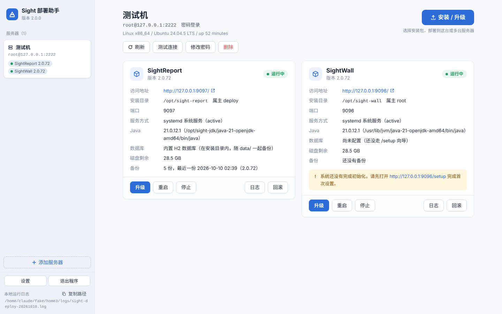
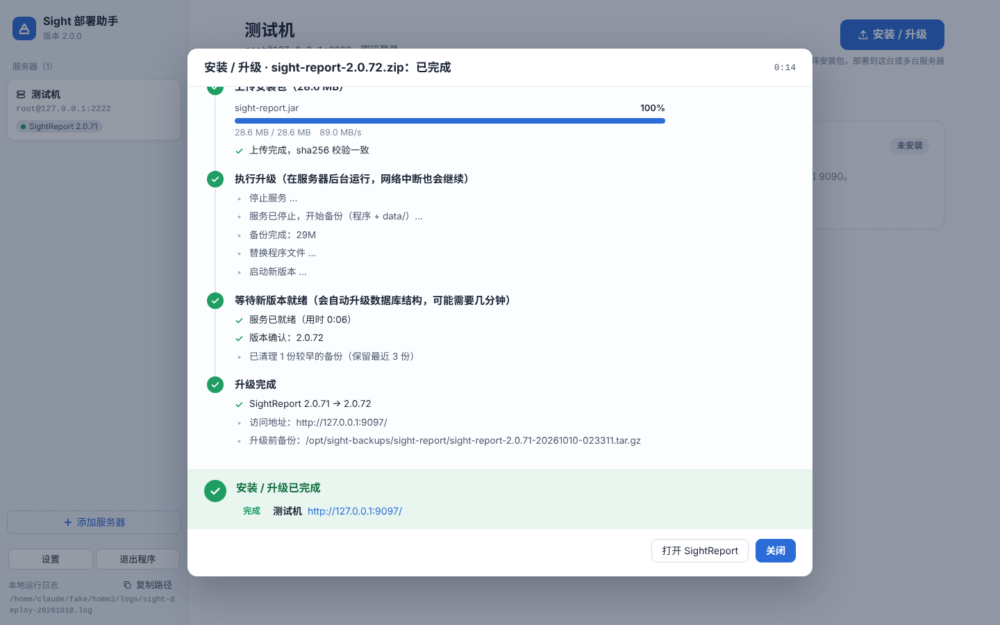

# Sight 部署助手

[](https://github.com/Sight-Data/sight_deploy/actions/workflows/build.yml)
[](https://github.com/Sight-Data/sight_deploy/releases)
[](LICENSE)
[](https://www.sightdata.top)

[**Sight Data**](https://www.sightdata.top) 旗下 **SightReport（报表）/ SightWall（数据大屏）/ DFDataLink（数据集成）** 的远程安装与升级工具。

双击打开，操作界面在浏览器里。通过 SSH 连到 Linux 服务器，三步完成部署：添加服务器 → 选择安装包 → 一键安装 / 升级。
不用敲命令，客户电脑上也不用装 Python。

<table>
<tr><td width="50%">

**服务器状态一目了然**



</td><td width="50%">

**升级过程全程可见，失败可一键回滚**



</td></tr>
</table>

> 截图中的地址、目录均为测试环境数据。

## 下载

| 系统 | 文件 | 说明 |
|---|---|---|
| Windows 10 / 11 | `sight-deploy-<版本>-windows-x64.exe` | 单文件，双击运行 |
| Windows 7 / 8 | `sight-deploy-<版本>-windows7-x64.exe` | Win7 兼容版（Python 3.8 构建）。系统自带的 IE 打不开操作界面，需要装 Chrome 109 或 Firefox ESR 115；程序会优先用它们打开 |
| macOS（Apple 芯片） | `sight-deploy-<版本>-mac-arm64.zip` | 解压后打开「Sight部署助手.app」 |
| macOS（Intel） | `sight-deploy-<版本>-mac-x86_64.zip` | 同上 |

- **GitHub**：[Releases](https://github.com/Sight-Data/sight_deploy/releases)
- **国内下载**：[Sight Data 官网下载中心](https://www.sightdata.top/downloads)

程序本身没有窗口，操作界面在浏览器里：
- **Windows**：运行后任务栏右下角通知区会出现它的图标（可能收在「^」里）。双击图标重新打开界面，右键「退出」关闭程序。
- 界面左下角也有「退出程序」按钮；关掉浏览器 10 分钟后，程序在没有任务进行时会自动退出。

程序没有做代码签名：
- **Mac**：第一次打开会提示「无法验证开发者」，右键 →「打开」即可。macOS 15 起要到「系统设置 › 隐私与安全性」点「仍要打开」。
- **Windows**：个别杀毒软件可能误报，加入信任即可。

SightReport / SightWall / DFDataLink 的产品安装包同样在[官网下载中心](https://www.sightdata.top/downloads)下载（DFDataLink 的包名为 `dfdatalink-<版本>.zip`）。

> DFDataLink 按它自己的 Sustainable Use License 分发，见 [LICENSING.md](https://github.com/qianxl2011/DataLink/blob/main/LICENSING.md)；本工具（Apache-2.0）只负责安装与升级。

## 能做什么

- **服务器管理**：支持 root 账号，或可以 sudo 的普通账号；支持密码或密钥登录。
  - 密码加密保存在本机，密钥与本机绑定。
  - 首次连接记录服务器指纹，下次指纹变了会提醒。
- **首次安装**：先检查环境，包括系统与 CPU 架构、systemd、Java 21、字体库、内存、磁盘、端口、防火墙。
  - 缺 Java 时可以上传本机的 JDK 包，自动核对版本和架构。服务器能联网的话，也可以用 yum/apt 在线安装。
  - 调用产品包里的 `install.sh` 注册成 systemd 服务，开机自启、崩溃自动拉起。
  - 健康检查通过后给出 `/setup` 初始化地址，需要的话顺手放行防火墙端口。
  - DFDataLink：首次启动进入安装向导（根路径 `/`），从服务日志里取出「初始化令牌」显示在完成页上（可一键复制，安装向导和之后的「初始化管理员」都要用它；令牌不写进本地日志）。元数据库连不上时说明服务在等待并自动重试。
- **升级**：
  - 服务还在运行时先上传安装包，支持断点续传和 sha256 校验，尽量缩短停机时间。
  - 「停服 → 备份程序和 `data/` → 替换程序 → 启动」这一段在服务器后台执行，网络断了也会执行完。
  - 启动后检查健康状态并核对版本号，失败时一键回滚，程序和数据一起恢复。
  - 用外部数据库时会提醒先备份数据库。
  - DFDataLink 用外部元数据库时，升级前必须勾选确认已备份；PostgreSQL 且服务器上有 `pg_dump` 时可勾选让本工具先备份到 `sight-backups/`（密码经 `PGPASSWORD` 传入，不出现在命令行和日志里）。升级前记录数据库结构版本（`schemaVersion`），回滚时外部库结构版本变了就拒绝只回滚程序，提示先用数据库备份恢复；内置 H2 在 `data/` 里，随备份一起恢复。
  - 可以多选服务器依次滚动升级，某台失败时会询问是否继续处理剩下的。DFDataLink 不做自动滚动升级：多选时提醒集群（共用外部库）要先全部停止、先升级一台等迁移完成再升级其余，确认后才依次处理。
- **在线检查更新**：启动时（可在设置里关闭）联网查询官网下载中心，只读取版本信息，不上传任何数据。
  - 部署助手有新版本时，页面顶部提示，点一下就下载到「下载」文件夹（断点续传）。
  - 服务器上的 SightReport / SightWall / DFDataLink 低于官网最新版时，在产品卡上标出；点「升级」会预选最新版，没下载过的自动从官网下载并校验，再部署。
  - 左下角「检查更新」随时手动检查，并汇总哪些服务器可升级。连不上官网（内网）时不影响使用，仍可用本机的安装包。
- **日常运维**：启动、停止、重启；查看日志（可实时跟踪）；回滚到任意一份升级备份。回滚前会先把当前状态另存一份，回滚本身也能撤销。

## 安全

- 网页服务只监听本机 `127.0.0.1`，每次启动生成一个随机令牌。接口只认请求头里的令牌，并拒绝跨站请求：浏览器里的其他网页用不了它。
- 本机保存的数据都在 `~/.sight-deploy/`：
  - `hosts.json`：服务器列表，敏感字段用 Fernet 加密。
  - `.key`：加密密钥，与本机绑定，配置文件拷到别的电脑上解不开。设环境变量 `SIGHT_DEPLOY_PASSPHRASE` 可以再加一层口令。
- 联网只有一件事：访问官网下载中心（`https://www.sightdata.top`）读版本信息、按你的操作下载安装包 / 新版工具；查不到时才退到 GitHub Release。内网环境可在设置里关闭「启动时自动检查更新」。
  - `logs/`：操作日志，不含任何密码，出问题时发给技术支持即可。
- sudo 密码通过标准输入传给 sudo，不出现在命令行、进程列表或日志里。

## 服务器端约定

与产品安装包里的 `install.sh` / `start.sh` 一致：

| 项 | 约定 |
|---|---|
| 安装目录 | 默认 `/opt/sight-report`、`/opt/sight-wall`、`/opt/dfdatalink` |
| 默认端口 | SightReport 9091、SightWall 9090、DFDataLink 18680 |
| 系统服务 | systemd 服务 `sight-report` / `sight-wall` / `dfdatalink` |
| 健康检查 | `/api/health`（`status=="UP"`；DFDataLink 另有 `mode=setup/waiting/normal` 与仅本机可见的 `schemaVersion`） |
| 升级备份 | `<安装目录上级>/sight-backups/<产品>/`，含程序文件与 `data/`；不含 logs（SightReport / SightWall 另不含 data/cache*、data/temp、data/backups；DFDataLink 的 `data/` 整个备份：向导配置与连接密钥、内置 H2、驱动、受管文件）；默认保留 3 份。DFDataLink 的备份元数据（`<备份>.json`）记录 `schema_version` |
| 文件属主 | SightReport / SightWall：整个安装目录交给运行账号；DFDataLink：与包内 `install.sh` 一致，程序文件归 root，只有 `data/`、`logs/` 归运行账号 |
| 数据库配置 | SightReport / SightWall：`data/work/database.config`、环境变量 `MR_DB_URL`；DFDataLink：`data/datalink.properties` 的 `DB_URL`，环境变量 / `dfdatalink.env` 里的 `DB_URL` 优先 |
| 初始化 | SightReport / SightWall：`/setup`；DFDataLink：安装向导在 `/`，令牌见服务日志「初始化令牌：」（无 systemd 时在 `logs/console.out`） |
| 非默认端口 | `/etc/systemd/system/<服务>.service.d/10-sight-deploy.conf` |
| 安装记录 | 安装目录下的 `.sight-deploy.json`（版本、端口、启动参数） |

支持的服务器：x86_64 / aarch64 的 Linux，有无 systemd 都可以（没有 systemd 时以后台进程方式运行）。

## 从源码运行

```bash
pip install paramiko
python3 sight_deploy.py                                 # 起服务并自动打开浏览器
python3 sight_deploy.py --no-browser --port 17880       # 只起服务，地址打印在控制台
```

- 单元测试（只用标准库）：`python3 -m unittest discover -s tests -v`。
- 只改界面时用假后端：`python3 web/mock_server.py 8765`，令牌是 `mocktoken123`。
- 调试在线检查：`SIGHT_DEPLOY_SITE=http://127.0.0.1:端口` 指向自己的假官网（只要实现 `/api/downloads` 和 `/downloads/file/<id>`）；`SIGHT_DEPLOY_PLATFORM=windows-x64|mac-arm64|mac-x86_64` 模拟平台。`mock_server.py --offline` 看连不上官网的界面。
- 前后端接口约定见 [`docs/API.md`](docs/API.md)。改接口时 `docs/API.md`、`sight_deploy.py`、`web/index.html` 三处一起改。

## 打包与发版

平时不用自己打包。改好代码后：

1. 把 `sight_deploy.py` 里的 `TOOL_VERSION` 改成新版本号，提交。
2. 打同名 tag 并推送（如 `git tag v2.0.1 && git push origin v2.0.1`）。

GitHub Actions 会在 Windows / macOS 真机上打包、冒烟自检，然后发布到 Releases。tag 和 `TOOL_VERSION` 对不上时构建会直接失败。

Win7 兼容版：`WIN7=1 python build.py`，必须用 Python 3.8 在 Windows 上打；CI 里是独立任务（`windows7`），失败不会拦住其他版本发布。

本地打包（PyInstaller 不能跨平台：Windows 版在 Windows 上打，Mac 版在 Mac 上打）：

```bash
bash build-mac.sh          # → dist/sight-deploy-<版本>-mac-<arch>.zip
build-windows.bat          # → dist\sight-deploy-<版本>-windows-x64.exe
```

- `PIP_INDEX_URL`：换国内 pip 源。
- `MAC_TARGET_ARCH=universal2`：打 Mac 通用包，需要 python.org 的通用版 Python。

## 许可

[Apache License 2.0](LICENSE) © [Sight Data](https://www.sightdata.top)
